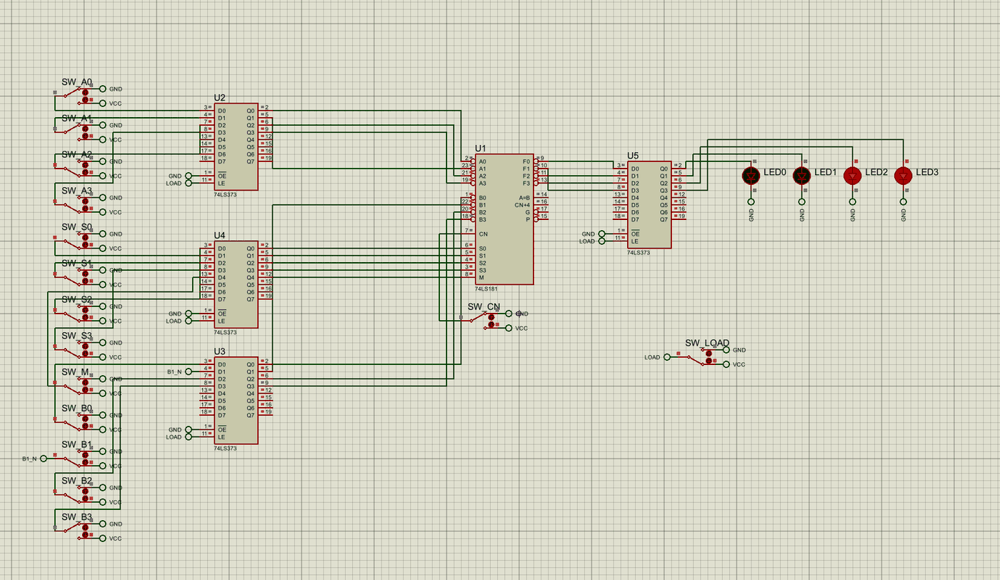
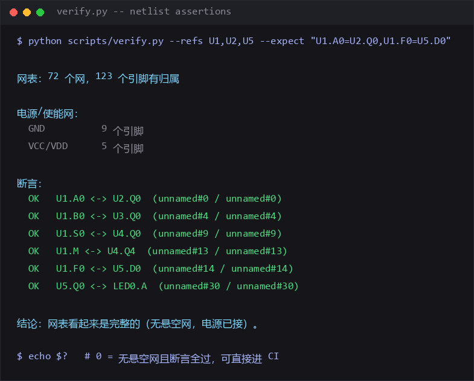

# proteus-mcp

> 补上 ProPilot MCP 缺的那一半：**不只是画得出来，还要证明画对了。**



*上图是 agent 从空白工程建出的 4 位 ALU —— 1×74LS181 + 4×74LS373 + 15×SW-SPDT + 4×LED，
全程走 MCP，没有一次鼠标点击。*

Proteus 9 的 ProPilot 已经在 `127.0.0.1:8001` 上摆好了 98 个工具——放件、布线、读网表、
跑仿真全都能调。它不管的是另外两件事：怎么用最少的代码稳定调到，以及**怎么确认接线真的对**。

这个仓库只做这两件事，再把踩过的坑原样写下来。

> **Client, not server.** 不打包 MCP 服务器、不接管 Proteus 进程、不模拟鼠标。
> 前提是你已经在用官方 ProPilot；这里提供的是那个"能跑、能断言、少踩坑"的调用层。

Drive Proteus 9's built-in ProPilot MCP from any agent: a zero-dependency JSON-RPC
client, netlist assertions that fail loudly, and 13 pitfalls found by actually drawing
a 4-bit ALU. No server, no GUI automation, no bundled vendor assets.

---

> **非官方项目 / Unofficial project.** Proteus 是 Labcenter Electronics Ltd. 的
> 注册商标，此处仅作描述性指代。本项目与 Labcenter 无隶属关系，未获其认可、
> 支持或赞助。使用前请确认你持有合法授权的 Proteus 副本。
> 本仓库只含文档与脚本，**不含** Labcenter 的任何代码、元件模型或元件库数据。

## 这是什么

Proteus 9 装好后，它自带的 AI 助手 **ProPilot** 会在本机起一个 **MCP 服务**
（JSON-RPC over HTTP，默认 `http://127.0.0.1:8001/`），暴露 **98 个工具**：
放元件、放端子、整网布线、读网表、导图纸、跑仿真、读波形、写固件、搜元件库。

这个仓库给它配了一套最小可用套件：

| 文件 | 作用 |
|---|---|
| `demo/minimal.py` | **60 秒样板**：2 片 373 + 4 开关 + 4 LED，从空白图纸建完并自证 13 条断言 |
| `scripts/mcpc.py` | 零依赖 MCP 客户端 + 命令行，任何能跑 shell 的 agent 直接可用 |
| `scripts/verify.py` | 网表核对：谁连了谁、哪里断了、电源接对没 |
| `AGENTS.md` | 给 agent 读的操作规程 + 18 条实测踩坑 |
| `examples/alu4bit.py` | 完整案例：4 位 ALU（74LS181 + 4×74LS373 + LED）全自动构建 |
| `SKILL.md` | 可直接装进 WorkBuddy / Claude Skills 的技能描述 |

## 做什么 / 不做什么

定位就一句话：**站在 ProPilot 之上，做调用层和验收层，不做替代品。**

| 做 | 不做 |
|---|---|
| 调 ProPilot 已有的 98 个工具，代码量压到一个文件 | 不自建 MCP 服务器、不造 bridge、不做本机校准 |
| 网表断言：`--expect "U1.A0=U2.Q0"`，不通过就非零退出码 | 不重复实现 ERC / DRC / BOM / PCB 布线——那是 Proteus 自己的活儿 |
| 把实测踩到的坑连同正解写进 `AGENTS.md` | 不打包、不转存任何元件库（`.LIB`）、模型（`.MODEL`）、工程（`.pdsprj`） |
| 一个从空白工程跑通的 4 位 ALU 例子 | 不承诺跨 Proteus 版本的参数兼容，也不追官方新版本 |

没有 Windows UI 自动化后端，也不需要——坐标是图纸单位、操作是原子事务、结果能读网表自证。

## 为什么不用 GUI 自动化

用 pywin32 模拟鼠标点 EDA 软件是很脆的：Windows DPI 缩放让坐标整体偏移、
中文输入法抢焦点把命令打成拼音、模态对话框卡死主流程、菜单项位置随版本漂移。
而 MCP 是软件自己暴露的接口——坐标是图纸单位（thou），操作是原子事务，
做完还能读网表自证。**能调接口就不要点鼠标。**

## 第一步：确认端点活着

前置：Proteus 已启动、已加载（或新建）一个工程、ProPilot 面板启用过。

```bash
python scripts/mcpc.py probe
#   http://127.0.0.1:8001/   OK   98 tools
#   http://127.0.0.1:8000/   --   cannot reach ...
#   http://127.0.0.1:8002/   --   cannot reach ...

python scripts/mcpc.py status
# {"data":{"status":{"schematic":{"current_design_id":"1","current_sheet_id":"1"}}}...}
```

拿到 `design_id` 后就能操作了。**不要硬编码 id**，用 `mcpc.ids()` 现取。

## 第二步：60 秒跑通第一张图

```bash
python demo/minimal.py
```

在一张**空白图纸**上放 2 片 74LS373、4 个开关、4 个 LED，连好线，然后自己读回网表核对 13 条断言：


```
[4/4] 逐网布线（一次只传一个 net，批量会部分失败）
  OK   IN0 ...  OK   Q3
[自检] 读网表核对 13 条断言
  OK   SW0.COM=U1.D0        (unnamed#0 / unnamed#0)
  ...
PASS 13/13 个断言全部通过
```

退出码 0 才算真跑通。这是整个仓库的出发点：**建完不验，等于没建**。
`demo/minimal.py` 只有 130 行，是把本仓库所有约定压到最小的那份样板。

## 标准流程

```python
import sys; sys.path.insert(0, "scripts")
from mcpc import call, ids

design, sheet = ids()                                    # 1. 现取 id
call("schematic_begin_transaction", {"id": design})       # 2. 开事务（整批一个 undo 步）
call("schematic_place_device", {                          # 3. 放件
    "id": design, "sheet": sheet, "name": "74LS181",
    "x": -600, "y": 2200, "reference": "U1",
    "value": "74LS181",          # 74LS 系列必须带 value，否则模型加载失败
})
call("schematic_place_terminal", {                        # 4. 打网络标号并连线
    "id": design, "sheet": sheet, "terminal_type": "DEFAULT",
    "label": "VCC", "anchor_ref": "SW_A0", "anchor_pin": "NO", "connect": True,
})
call("schematic_route_nets", {                            # 5. 逐网布线（一次一个网！）
    "id": design, "sheet": sheet,
    "nets": [{"name": "A0", "pins": [{"ref": "SW_A0", "name": "COM"},
                                     {"ref": "U2", "name": "D0"}]}],
})
call("schematic_end_transaction", {"id": design})         # 6. 提交，网表重编译
netlist = call("schematic_get_netlist", {"id": design, "sheet": sheet})
```

构建完一定要跑 `verify.py`，别靠图看着像连上了。它把"看起来连着"变成"断言通过 + 退出码 0"：



上图的输出就来自那张 4 位 ALU：72 个网、123 个引脚有归属、GND 9 脚、VCC 5 脚，断言全过。
任何一条对不上，`verify.py` 会打印 `FAIL` 并返回 1，可以直接挂到 CI 里。

## 工具地图（98 个）

| 前缀 | 数量 | 用途 |
|---|---|---|
| `schematic_*` | 27 | 放件、放端子、布线、网表、图纸、故障注入、网格 |
| `graph_*` | 18 | 波形图：加轨迹、测量、比对、导出 |
| `firmware_*` | 14 | 固件工程：建文件、编译、烧录、外设 |
| `interactive_*` | 12 | 实时仿真：run/pause/stop、日志、元件状态、探针 |
| `ui_*` | 6 | 对话框：列出、描述、回答、截图 |
| `library_*` | 5 | 元件库：搜索、预览、导入 |
| `file_*` | 5 | 打开、保存、另存、列目录、退出 |
| 其他 | 11 | `command_*` 菜单命令、`get_*` 状态、`set_*` 标题 |

常用：`get_current_status`、`schematic_begin_transaction`、`schematic_place_device`、
`schematic_place_terminal`、`schematic_route_nets`、`schematic_end_transaction`、
`schematic_get_netlist`、`schematic_get_image`、`schematic_rewind`、
`interactive_runctrl`、`interactive_get_log`。

```bash
python scripts/mcpc.py tools schematic      # 按关键字列
python scripts/mcpc.py schema route_nets    # 看完整参数说明
```

## 实测踩到的坑

| # | 现象 | 原因 / 正解 |
|---|---|---|
| 1 | 连本机端口返回 **502 Bad Gateway** | 系统 `HTTP_PROXY` 把 `127.0.0.1` 也转给代理了。客户端必须 **禁用代理**（`mcpc.py` 用 `ProxyHandler({})`） |
| 2 | 响应解析失败 | 端点可能返回 **SSE**（`data: {...}`），要先剥前缀再 `json.loads` |
| 3 | 调用"成功"但什么也没发生 | 业务错误放在 `result.content[0].text` 里、以 `Error:` 开头，**没有 `isError` 标志**，只能靠前缀判断 |
| 4 | 一批网布线只成功一部分 | 官方说明写着"可以一次传多个网"，但**实测批量会偶发部分失败且难定位**。稳妥做法：`route_nets` 一次一个 net 循环调用 |
| 5 | GND/VCC 到处短路 | 用**电源端子走线**时端子会自动吸附邻近线。改用 `terminal_type: DEFAULT` + `connect: true` 打网络标号；多引脚电源轨用 `nets` 里的 `terminals` 字段 |
| 6 | 仿真报模型加载失败 | `74LSxxx` 放件时没带 `value`，器件 VALUE 为空。放件当场把 `value` 设成器件名 |
| 7 | 标号打不上、线被改 | 顺序错了。**先打标号，再布其余线**，否则标号抢不到通道 |
| 8 | 想撤销一整批 | 提交前用 `begin/end_transaction` 包起来；已提交用 `schematic_rewind`（`direction: undo/redo`，`count`） |
| 9 | 图纸导出拿到空白 SVG | `schematic_get_image` **只返回 SVG**，schema 里写的 `format` 参数实测会被拒（`Error: Unknown parameter: format`）。要 PNG 只能系统截屏 |
| 10 | 元件全飘到图外 | 坐标单位是 **thou**（100 thou = 0.1" = 1 网格），原点在**图纸中心**，所以坐标有负值。首次照已有器件坐标取参照 |
| 11 | 网表里 VCC/GND 出现在奇怪位置 | TTL 的电源引脚以 `Power Pin` 类型出现在网表里，属正常；`$OE$`、`LE` 这类使能脚要自己接 |
| 12 | 明明没占线，`routed: 0` 布不过去 | 两个器件之间的**通道不够宽**。N 根线要过同一个缺口，至少需要 (N+1) 个网格宽度；可用 `bus_grid: 50`（或 25）把折线列压细，或干脆挪开器件 |
| 13 | 布线报告里的长度数字对不上 | 报告里的几何量是 Proteus base unit，**不是 thou**。只信 `corners` / `diagonal` / `over_corners`，别拿绝对长度算距离 |
| 14 | 在线读网表永远返回 0 个网 | 返回体是 `{"data": {"nets": ...}, "message": ...}`，比离线导出多包一层。`verify.py` 已自动剥壳，自己写代码时别直接读 `resp["nets"]` |
| 15 | `file_save` 一直不返回、超时 | 用 Proteus 8.x 建的工程存盘时会弹「File will be saved in version 9.2 format」模态框，等不到确认就卡住。要么人工点一下，要么用 `SendMessage` 给按钮发消息（Qt 窗口不认 `BM_CLICK`，得发回车） |
| 16 | `get_component_info` 报 "reads the compiled netlist" | 它读的是编译后的网表，事务没提交前不可用。先 `end_transaction`；如果只是想中途看一眼，用 `get_image` 或 `get_object_geometry` |
| 17 | 第二次 `begin_transaction` 报 nested | 每次 `begin` 必须配对一次 `end`。批量脚本里失败重试很容易漏掉，导致事务层层嵌套；`abandon: true` 只对最外层有效，得先用普通 `end` 逐层关掉 |
| 18 | 打标号报 "would overlap the existing terminal(s)" | 两个网络标号抢同一块地方。把器件间距拉大，或者干脆斜着错开（比如 LED 竖排时每条横移 800 thou） |

## 4 位 ALU 案例

`examples/alu4bit.py` 从空白工程构建：

```
SW_A0..A3 → U2(373) → 74LS181.A      SW_B0..B3 → U3(373) → 74LS181.B
SW_S0..S3 → U4(373) → 74LS181.S      SW_M → U4.D4 → 74LS181.M
SW_CN ─────────────→ 74LS181.CN      74LS181.F → U5(373) → LED0..3
SW_LOAD → 四片 373 的 LE（1=透明，0=保持）
```

元件：1×74LS181、4×74LS373、15×SW-SPDT、4×LED-RED。
跑完用 `verify.py` 核对，34 条信号网全通、GND 9 脚、VCC 5 脚。

## 适用边界

| 项 | 实测值 |
|---|---|
| Proteus | 9.x Professional。ProPilot 是 9 才引入的，8.x 及更早没有这个端点 |
| 端点 | `http://127.0.0.1:8001/`，Proteus 在运行且 ProPilot 面板启用过才会监听 |
| 系统 | Windows（Proteus 自身的限制） |
| Python | 3.8+，**无第三方依赖**，只用标准库 |
| 生效范围 | 原理图 + 实时仿真。PCB、ERC/DRC、BOM、器件库编辑不在射程内 |

参数随 ProPilot 版本变化，**以 `mcpc.py schema` 打印的实时 schema 为准**，别照抄本文档里的参数名。

## 声明

- 非官方项目，与 Labcenter Electronics Ltd. 无隶属关系，**未获其认可、支持或赞助**。
- **Proteus** 是 Labcenter Electronics Ltd. 的注册商标，本项目仅在描述兼容对象时指代该名称。
- 使用本仓库需要你**合法持有 Proteus 许可证**。本项目不提供、不协助获取任何授权绕过方式，
  也不包含任何可用于绕过授权的代码或说明。
- 本仓库只包含文档与脚本，**不含** Labcenter 的任何代码、元件模型（`.MODEL`）、
  元件库（`.LIB`）或原理图文件（`.pdsprj`），请勿把此类文件通过本项目的 issue / PR 提交。
- 接口参数由运行时 `tools/list` 探测所得，随 ProPilot 版本变化可能失效；
  一切以实时 schema 为准。作者不对因使用本项目产生的任何后果负责。
