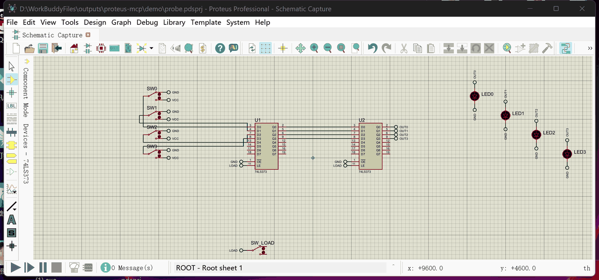

# proteus-mcp


*图里这块是计组实验的 4 位 ALU：1 片 74LS181、4 片 74LS373、15 个拨动开关、4 个 LED。
它从一张空白图纸开始，由脚本调接口画出来，全程没碰鼠标。*

Proteus 9 装好之后，自带的 ProPilot 会在本机起一个 MCP 服务
（JSON-RPC over HTTP，默认 `http://127.0.0.1:8001/`），里面有 98 个工具：
放元件、放端子、整网布线、读网表、导图纸、跑仿真、写固件、搜元件库。

接口本身能用，但我接上去画电路的时候踩到两个问题。一是它返回的东西套了几层，
出错时不给你 `isError`，只在一段文本里以 `Error:` 开头，直接 `json.loads` 会以为调用成功。
二是它不在乎你画得对不对，线断了、电源接错、器件 VALUE 为空，图上看不出来。

所以这里有三个东西：一个能直接调的客户端，一个把网表读回来逐脚核对的脚本，
以及画完那张 ALU 之后整理的 18 个坑。

> **这是客户端，不是服务器。** 不打包 MCP 服务、不接管 Proteus 进程、不模拟鼠标。
> 前提是你已经在用官方的 ProPilot，这里只提供调它的那一层。

Drive Proteus 9's built-in ProPilot MCP from your own script: a stdlib-only JSON-RPC
client, a netlist checker that exits non-zero when the wiring is wrong, and the pitfalls
found while drawing a 4-bit ALU. No server, no GUI automation, no vendor assets.

---

> **非官方项目 / Unofficial project.** Proteus 是 Labcenter Electronics Ltd. 的
> 注册商标，此处仅作描述性指代。本项目与 Labcenter 无隶属关系，未获其认可、
> 支持或赞助。使用前请确认你持有合法授权的 Proteus 副本。
> 本仓库只含文档与脚本，**不含** Labcenter 的任何代码、元件模型或元件库数据。

## 里面有什么

| 文件 | 作用 |
|---|---|
| `demo/minimal.py` | 最小的例子：2 片 373 + 4 个开关 + 4 个 LED，从空白图纸建完并自检 13 条断言 |
| `scripts/mcpc.py` | 零依赖客户端，带命令行，只用标准库 |
| `scripts/verify.py` | 读网表核对：谁连了谁、哪里断了、电源接对没 |
| `AGENTS.md` | 给 agent 看的操作规程，以及踩坑对照表 |
| `examples/alu4bit.py` | 上面那张 ALU 的构建脚本 |
| `SKILL.md` | 能直接装进 WorkBuddy / Claude Skills 的技能描述 |

## 做什么，不做什么

Proteus 自己能干的活儿我不重写一遍，只补它没管的部分。

| 做 | 不做 |
|---|---|
| 调现成的 98 个工具，代码压在一个文件里 | 不自建 MCP 服务器，不造 bridge，不做本机校准 |
| 网表断言：`--expect "U1.A0=U2.Q0"`，不对就非零退出码 | 不重写 ERC / DRC / BOM / PCB 布线 |
| 把踩到的坑和正解写进 `AGENTS.md` | 不打包、不转存元件库（`.LIB`）、模型（`.MODEL`）、工程（`.pdsprj`） |
| 一个从空白工程真跑通的 ALU 例子 | 不承诺跨版本参数兼容 |

## 为什么不用模拟鼠标

我一开始用的是 pywin32，找窗口、算坐标、点菜单。DPI 缩放 175% 的时候坐标整体偏了一截，
中文输入法抢焦点把命令打成了拼音，某个模态框弹出来还会把整个流程卡死。
折腾一下午，画出来的东西还不如手点。

后来才发现 Proteus 自己开着接口。走接口之后，坐标是图纸单位（thou），
一批操作是一个事务，做完能读网表验证。这两条路差别很大，能调接口就别点鼠标。

## 第一步：确认端点活着

前置：Proteus 已启动、已打开或新建一个工程、ProPilot 面板启用过。

```bash
python scripts/mcpc.py probe
#   http://127.0.0.1:8001/   OK   98 tools
#   http://127.0.0.1:8000/   --   cannot reach ...
#   http://127.0.0.1:8002/   --   cannot reach ...

python scripts/mcpc.py status
# {"data":{"status":{"schematic":{"current_design_id":"1","current_sheet_id":"1"}}}...}
```

`design_id` 每次现取（`mcpc.ids()`），不要写死。重新打开工程之后它会变。

## 第二步：跑通第一张图

```bash
python demo/minimal.py
```

它会在一张空白图纸上放 2 片 74LS373、4 个开关、4 个 LED，连好线，
然后自己把网表读回来核对 13 条断言：



```
[4/4] 逐网布线（一次只传一个 net，批量会部分失败）
  OK   IN0 ...  OK   Q3
[自检] 读网表核对 13 条断言
  OK   SW0.COM=U1.D0        (unnamed#0 / unnamed#0)
  ...
PASS 13/13 个断言全部通过
```

看到退出码 0 才算跑通。这 130 行是仓库里所有约定的最小缩影，改别的脚本之前先把它跑一遍。

## 一般流程

```python
import sys; sys.path.insert(0, "scripts")
from mcpc import call, ids

design, sheet = ids()                                    # 1. 现取 id
call("schematic_begin_transaction", {"id": design})       # 2. 开事务（整批一个 undo 步）
call("schematic_place_device", {                          # 3. 放件
    "id": design, "sheet": sheet, "name": "74LS181",
    "x": -600, "y": 2200, "reference": "U1",
    "value": "74LS181",          # 74LS 系列必须带 value，否则模型加载失败
})
call("schematic_place_terminal", {                        # 4. 打网络标号并连线
    "id": design, "sheet": sheet, "terminal_type": "DEFAULT",
    "label": "VCC", "anchor_ref": "SW_A0", "anchor_pin": "NO", "connect": True,
})
call("schematic_route_nets", {                            # 5. 逐网布线（一次一个网！）
    "id": design, "sheet": sheet,
    "nets": [{"name": "A0", "pins": [{"ref": "SW_A0", "name": "COM"},
                                     {"ref": "U2", "name": "D0"}]}],
})
call("schematic_end_transaction", {"id": design})         # 6. 提交，网表重编译
netlist = call("schematic_get_netlist", {"id": design, "sheet": sheet})
```

画完记得读网表，图看着连上了不等于真连上了。`verify.py` 把这件事变成一条能挂 CI 的命令：


上面这张是那张 ALU 的输出：72 个网、123 个引脚有归属、GND 9 个脚、VCC 5 个脚，断言全过。
有一条对不上它就打印 `FAIL` 并返回 1。

## 工具分布（98 个）

| 前缀 | 数量 | 用途 |
|---|---|---|
| `schematic_*` | 27 | 放件、放端子、布线、网表、图纸、故障注入、网格 |
| `graph_*` | 18 | 波形图：加轨迹、测量、比对、导出 |
| `firmware_*` | 14 | 固件工程：建文件、编译、烧录、外设 |
| `interactive_*` | 12 | 实时仿真：run/pause/stop、日志、元件状态、探针 |
| `ui_*` | 6 | 对话框：列出、描述、回答、截图 |
| `library_*` | 5 | 元件库：搜索、预览、导入 |
| `file_*` | 5 | 打开、保存、另存、列目录、退出 |
| 其他 | 11 | `command_*` 菜单命令、`get_*` 状态、`set_*` 标题 |

画原理图常用的那几个：`get_current_status`、`schematic_begin_transaction`、
`schematic_place_device`、`schematic_place_terminal`、`schematic_route_nets`、
`schematic_end_transaction`、`schematic_get_netlist`、`schematic_get_image`、
`schematic_rewind`、`interactive_runctrl`、`interactive_get_log`。

```bash
python scripts/mcpc.py tools schematic      # 按关键字列
python scripts/mcpc.py schema route_nets    # 看完整参数说明
```

## 踩过的坑

| # | 现象 | 原因 / 怎么绕 |
|---|---|---|
| 1 | 连本机端口返回 **502 Bad Gateway** | 系统 `HTTP_PROXY` 把 `127.0.0.1` 也转给代理了。客户端里要禁用代理（`mcpc.py` 用 `ProxyHandler({})`） |
| 2 | 响应解析失败 | 端点可能回 SSE（`data: {...}`），得先剥前缀再 `json.loads` |
| 3 | 调用"成功"但什么也没发生 | 业务错误放在 `result.content[0].text` 里、以 `Error:` 开头，没有 `isError` 标志，只能靠前缀判断 |
| 4 | 一批网布线只成功一部分 | 说明里写着能一次传多个网，实测会偶发部分失败而且很难定位。一次传一个，循环调用 |
| 5 | GND/VCC 到处短路 | 用电源端子走线时，端子会自动吸附邻近的线。改用 `terminal_type: DEFAULT` + `connect: true` 打标号；多引脚电源轨用 `nets` 里的 `terminals` 字段 |
| 6 | 仿真报模型加载失败 | `74LSxxx` 放件时没带 `value`，器件 VALUE 是空的。放件当场把 `value` 设成器件名 |
| 7 | 标号打不上、线被改 | 顺序反了。先打标号，再布其余线 |
| 8 | 想撤销一整批 | 提交前用 `begin/end_transaction` 包起来；已提交用 `schematic_rewind`（`direction: undo/redo`，`count`） |
| 9 | 图纸导出拿到空白 SVG | `schematic_get_image` 只回 SVG，schema 里写的 `format` 参数会被拒（`Error: Unknown parameter: format`）。要 PNG 只能系统截屏 |
| 10 | 元件全飘到图外 | 坐标单位是 thou（100 thou = 0.1"，一格），原点在图纸中心，所以坐标是负的。第一次画就照已有器件的位置取参照 |
| 11 | 网表里 VCC/GND 出现在奇怪的位置 | TTL 的电源脚以 `Power Pin` 类型进网表，这是正常的；`$OE$`、`LE` 这类使能脚得自己接 |
| 12 | 明明没占线，`routed: 0` 布不过去 | 两个器件之间的缺口不够宽。N 根线要挤过同一个缺口，至少得 (N+1) 格；可以用 `bus_grid: 50`（或 25）压细折线，或者干脆挪开器件 |
| 13 | 布线报告里的长度对不上 | 报告里的几何量是 Proteus base unit，不是 thou。只信 `corners` / `diagonal` / `over_corners`，别拿绝对长度算距离 |
| 14 | 在线读网表永远返回 0 个网 | 返回体是 `{"data": {"nets": ...}, "message": ...}`，比离线导出多包一层。`verify.py` 已经自动剥壳，自己写代码别直接读 `resp["nets"]` |
| 15 | `file_save` 一直不返回、超时 | 8.x 建的工程存盘时会弹「File will be saved in version 9.2 format」模态框，等不到确认就卡死。点一下，或者给按钮发回车（Qt 窗口不认 `BM_CLICK`） |
| 16 | `get_component_info` 报 "reads the compiled netlist" | 它读编译后的网表，事务没提交之前用不了。先 `end_transaction`；中途想看用 `get_image` 或 `get_object_geometry` |
| 17 | 第二次 `begin_transaction` 报 nested | 每次 `begin` 要配对一次 `end`。脚本里失败重试很容易漏，事务就套起来了；`abandon: true` 只对最外层有效，得先用普通 `end` 一层层关掉 |
| 18 | 打标号报 "would overlap the existing terminal(s)" | 两个标号抢同一块地方。把器件拉开，或者斜着错开（LED 竖排时每条横移 800 thou 就行） |

## 那张 ALU 的连接

`examples/alu4bit.py` 从空白工程建出来的东西：

```
SW_A0..A3 → U2(373) → 74LS181.A      SW_B0..B3 → U3(373) → 74LS181.B
SW_S0..S3 → U4(373) → 74LS181.S      SW_M → U4.D4 → 74LS181.M
SW_CN ─────────────→ 74LS181.CN      74LS181.F → U5(373) → LED0..3
SW_LOAD → 四片 373 的 LE（1=透明，0=保持）
```

元件是 1×74LS181、4×74LS373、15×SW-SPDT、4×LED-RED。跑完用 `verify.py` 核对，
34 条信号网全通、GND 9 个脚、VCC 5 个脚。

## 能用在哪

| 项 | 实测 |
|---|---|
| Proteus | 9.x Professional。ProPilot 是 9 才有的，8.x 及更早没这个端点 |
| 端点 | `http://127.0.0.1:8001/`，Proteus 在跑、且 ProPilot 面板启用过才会监听 |
| 系统 | Windows（Proteus 自己的限制） |
| Python | 3.8+，无第三方依赖 |
| 范围 | 原理图 + 实时仿真。PCB、ERC/DRC、BOM、器件库编辑不在这里 |

参数跟着 ProPilot 版本走，以 `mcpc.py schema` 打印的实时 schema 为准，别照抄本文档里的参数名。

## 声明

- 非官方项目，与 Labcenter Electronics Ltd. 无隶属关系，未获其认可、支持或赞助。
- **Proteus** 是 Labcenter Electronics Ltd. 的注册商标，本项目仅在描述兼容对象时指代该名称。
- 使用本仓库需要你合法持有 Proteus 许可证。本项目不提供、不协助获取任何授权绕过方式，
  也不包含可用于绕过授权的代码或说明。
- 仓库里只有文档与脚本，不含 Labcenter 的任何代码、元件模型（`.MODEL`）、
  元件库（`.LIB`）或原理图文件（`.pdsprj`）。这类文件请不要通过 issue / PR 提交。
- 接口参数是运行时从 `tools/list` 探测来的，ProPilot 改版后可能失效。
  用之前先跑一遍 `mcpc.py probe`。
